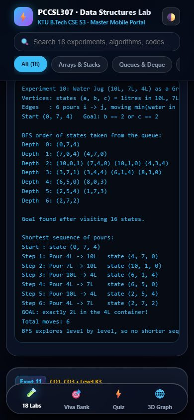
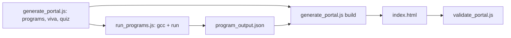

# Data Structures Lab Portal: all 18 KTU PCCSL307 experiments with compiled-and-run C programs

[](https://creativecommons.org/licenses/by-nc-nd/4.0/)

## Overview

A single-file, mobile-first study portal for the KTU B.Tech CSE S3 **PCCSL307 Data Structures Lab**. Each of the 18 syllabus experiments has a step-by-step algorithm, a flowchart, a complete C program, the real output of that program, an animated walkthrough and a real-world use case. It also has a viva question bank, a quiz and a knowledge graph. Used for teaching the lab course.

## Demo

Live: https://janeferdinant.github.io/dsa/ (GitHub Pages, served from `main`). The portal is one self-contained file at `index.html` and makes no external requests, so you can also open it directly in a browser or serve the folder (see Getting started).



## Problem statement

Students in the KTU lab need correct, readable C implementations of 18 data-structure tasks, and they copy what they find. Every program on this portal implements the whole task given in the syllabus, builds without warnings, and its "terminal output" panel shows what the program really prints.

## Approach

- `scripts/generate_portal.js` is the single source: it holds the experiment data (including every C program), the viva bank and the quiz, and writes `index.html` and its mirror `PCCSL307_Data_Structures_Lab_Portal.html`.
- `scripts/run_programs.js` compiles every embedded program with `gcc -Wall -Wextra -std=c11 -pedantic` (any warning fails), runs it, and stores the real output in `scripts/program_output.json` together with a hash of the program. The generator reads that file for the output panels and refuses to build if a program changed since it was last run, so no output is typed by hand.
- `tests/validate_portal.js` checks the generated HTML, the counts, and that the panels equal the recorded output.



| Expt | Task (KTU syllabus) |
|---|---|
| 1 | Sum of two sparse polynomials using arrays |
| 2 | Transpose of a sparse matrix and sum of two sparse matrices |
| 3 | Infix to postfix, then evaluate with a stack |
| 4 | Queue, DEQUEUE and circular queue using arrays |
| 5 | Browser back and forward with a doubly linked list |
| 6 | Polynomial addition and multiplication with singly linked lists |
| 7 | Binary tree for an arithmetic expression, prefix and postfix |
| 8 | Word-meaning dictionary with a binary search tree |
| 9 | Shortest distance from a landmine in a maze |
| 10 | Water jug problem (10 L, 7 L, 4 L) as a graph (BFS) |
| 11 | Find and replace in a text editor |
| 12 | Efficient search in a sorted array |
| 13 | Bubble, insertion, radix, quick and merge sort, with step counts |
| 14 | Post office priority queue |
| 15 | Spell checker with a hash table |
| 16 | Memory allocator and garbage collector with a doubly linked list |
| 17 | Tech fest: maximum activity points |
| 18 | Merge K sorted lists with a min-heap |

## Data

No datasets. All sample inputs are small values hard-coded in the programs. The viva (36 questions) and quiz (15 questions) banks were written for this portal. No student data. Experiment 14 uses sample customer names that appear to be fictional; the owner is asked to confirm (see the PR).

## Results

This is a teaching tool with no performance metrics. Verification (run log: [`docs/runs/2026-10-13-dsa-programs-and-tests.md`](docs/runs/2026-10-13-dsa-programs-and-tests.md)):

| Check | Value | Status | How measured | Date |
|---|---|---|---|---|
| C programs compile warning-free | 18 of 18 | Verified (re-run 2026-10-14) | `gcc -Wall -Wextra -std=c11 -pedantic`, GCC 16.2.0 | 2026-10-14 |
| C programs run, exit code 0, deterministic | 18 of 18 | Verified (re-run 2026-10-14) | `node scripts/run_programs.js` | 2026-10-14 |
| Static analysis (`-fanalyzer`) | 18 of 18 clean | Verified (re-run 2026-10-14, after adding NULL checks and cleanup to exp05 and exp08) | `gcc -Wall -Wextra -std=c11 -pedantic -fanalyzer -c`, GCC 16.2.0 | 2026-10-14 |
| Portal tests | 45 passed, 0 failed | Verified (re-run 2026-10-14) | `node tests/validate_portal.js` | 2026-10-14 |
| Browser checks at 390 px and 1280 px | all passed, no console errors, no overflow, no external requests | Verified (re-run 2026-10-14) | Playwright 1.59.1, Chromium | 2026-10-14 |
| Viva questions / quiz questions | 36 / 15 | Verified (re-run 2026-10-14) | counted in the generated HTML | 2026-10-14 |

An earlier README said 37 viva and 16 quiz questions. That came from the test counting the JavaScript row templates as items; the real counts are 36 and 15.

## Tech stack

C11 (programs), Node.js (generator and tests), plain HTML, CSS and JavaScript (portal, no external requests). GCC to compile the programs.

## Getting started

Prerequisites: Node.js 20 or newer (tested on 22.20.0). GCC is needed only to re-run the programs (tested with GCC 16.2.0).

```bash
git clone https://github.com/Janeferdinant/dsa.git
cd dsa
node tests/validate_portal.js
```

Expected: `Results: 45 passed, 0 failed`. To view the portal, open `index.html` in a browser, or run `python -m http.server 8000` and open http://localhost:8000/.

After changing any C program in `scripts/generate_portal.js`:

```bash
node scripts/run_programs.js
node scripts/generate_portal.js
node tests/validate_portal.js
```

Expected: `ok exp01` through `ok exp18` and `Wrote program_output.json for 18 programs.`, then `Build completed successfully!`, then `Results: 45 passed, 0 failed`. To compile one program by hand, copy it from the portal into `expNN.c` and run `gcc -Wall -Wextra -std=c11 -o expNN expNN.c`.

## Project structure

```text
index.html                                   portal (generated)
PCCSL307_Data_Structures_Lab_Portal.html     identical mirror of index.html (generated)
PCCST303_DSA_KTU_Solved_Scheme_Quiz_...html  theory page: solved scheme, quiz and knowledge graph (not covered by the lab tests)
scripts/generate_portal.js                   single source and portal generator
scripts/run_programs.js                      compiles and runs every C program
scripts/program_output.json                  recorded real output (generated, committed)
tests/validate_portal.js                     portal tests (45 assertions)
tests/e2e_portal.js                          Playwright check at 390 px and 1280 px
syllabus.pdf, syllabus_extracted.txt         KTU syllabus reference
docs/                                        screenshots, run logs, design spec and plan
vercel.json                                  clean-URL setting (not used by GitHub Pages)
```

## Real-world applications

Each experiment card lists its own: for example compilers (expression conversion), schedulers (priority queues), web browsers (history lists), memory allocators, spell checkers and routing.

## Limitations

- Programs read no input; they run on fixed sample data so the output is reproducible.
- The animated demos are scripted walkthroughs of sample data, not a run of the C code. Only experiments 1, 4, 10 and 12 have a custom visualiser; the others use a generic one.
- Sample data is fictional: experiment 14 uses generic labels (Customer A to D) rather than names.
- The theory page overflows by about 62 px on a 390 px screen.
- `syllabus_extracted.txt` only holds page markers, not extracted text.

## Future scope

- Custom visualisers for the remaining experiments.

## Credits & citation

Experiment list: KTU PCCSL307 Data Structures Lab syllabus (APJ Abdul Kalam Technological University). See THIRD_PARTY_NOTICES.md. The portal was built with an AI-assisted spec and plan workflow; the specs and plans are in `docs/superpowers/`.

## License

[CC BY-NC-ND 4.0](LICENSE). Original work © Jane Rose Ferdinant, licensed CC BY-NC-ND 4.0. Third-party components retain their own licenses; see THIRD_PARTY_NOTICES.md.

## Author

Jane Rose Ferdinant: [portfolio](https://janeferdinant.vercel.app) · [LinkedIn](https://www.linkedin.com/in/janerosenf/)
